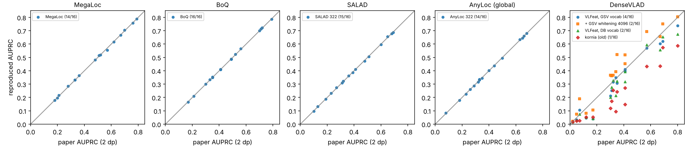

# Kết quả tái lập VPR-Space trên 16 cặp DB/Q

*Fechner & Neubert, "VPR-Space: A Benchmark for Visual Place Recognition in Space Analog Domains", arXiv:2610.35642. Cập nhật 07/11/2026. Mọi số liệu dưới đây lấy từ `results/runs/` (JSON metric của từng phiên), sinh bằng `vprspace_repro/compare.py`.*

## 1. Tóm tắt

| Phương pháp (cột Bảng II) | Cấu hình của chúng tôi | Khớp Bảng II (làm tròn 2 số) | \|Δ\| trung bình | Trung bình AUPRC (ta / bài) |
|---|---|---|---|---|
| **BoQ** | code `methods.py` của tác giả, môi trường ghim | **16/16** | 0,0025 | 0,469 / 0,47 |
| **MegaLoc** | code `methods.py` của tác giả, môi trường ghim | **14/16** | 0,0037 | 0,469 / 0,47 |
| **SALAD** | DINOv2-B, ảnh 322×322 (ToTensor → Resize bicubic+antialias → Normalize) | **15/16** | 0,0033 | 0,394 / 0,39 |
| **AnyLoc (global)** | DINOv2 ViT-G/14 L31 value, 32 cụm, ảnh 322×322 | **14/16** | 0,0031 | 0,395 / 0,40 |
| **DenseVLAD** | VLFeat `vl_phow` gốc, 640 px; vocabulary học trên ảnh phố GSV-Cities (gần nhất theo cặp) | 4/16 | 0,042 | 0,314 / 0,35 (tương quan theo cặp 0,983) |

Kết luận ngắn:

1. **BoQ được tái lập chính xác**: Bảng II 16/16 (cả 3 hàng tổng hợp), Bảng III 12/12 ô, Hình 6a 2/2 giá trị, Hình 6b giá trị "best correct". Hình 6c lệch 0,001 ở cả hai giá trị (0,0183 và 0,1811 so với 0,019 và 0,182).
2. **MegaLoc khớp 14/16.** Lệch thật sự duy nhất là **MM G0–G2** (0,553 so với 0,57). Ô còn lại (SPAD noon–night 0,21500 so với 0,21) nằm đúng biên làm tròn. Bảng III khớp 11/12 ô.
3. **SALAD** (15/16) và **AnyLoc-global** (14/16) gần như khớp hoàn toàn khi dùng **độ phân giải 322×322**. Đây là kích thước tác giả dùng cho BoQ. Hai cấu hình này không được bài báo công bố; chúng tôi xác định bằng cách quét độ phân giải chọn trước (224/322/518/native).
4. **DenseVLAD không thể tái lập chính xác**: vocabulary và PCA gốc của Torii đã mất. Bản VLFeat với vocabulary và whitening học trên ảnh phố GSV-Cities bao quanh số của bài: AUPRC 0,314–0,397 so với 0,35; tương quan theo cặp 0,97–0,98; Bảng III gần trùng (§6).
5. Kết quả **ổn định**: đổi batch size, môi trường (gói ghim hay mặc định Kaggle) hoặc GPU (L4 hay T4) chỉ làm AUPRC thay đổi tối đa 8·10⁻⁴.

## 2. Thiết lập

- **Dữ liệu**: bản phát hành `vpr-space-v0`, 11 phần tar. SHA-256 của từng phần khớp với giá trị công bố; 8.998 thành phần, 25 trajectory, 8.784 ảnh.
  - Ảnh `MadMax-E0/0293.png` bị **cắt cụt** trong bản phát hành: thiếu chunk IEND, chỉ giải mã được 1.387/1.544 hàng.
  - Chúng tôi đọc phần giải mã được (`PIL ImageFile.LOAD_TRUNCATED_IMAGES=True`). Cách này cho đúng số của bài báo ở cặp E0–E1 (BoQ 0,3007 → 0,30; MegaLoc 0,3315 → 0,33).
- **Ground truth**: dùng `vpr_gt/VPR-GT-RPE-0` phát hành.
  - Chúng tôi dựng lại bước bỏ phiếu từ `misc/rpe_estimates` với ngưỡng Bảng V. Kết quả khớp **100%** ma trận hard/soft của cả 16 cặp (`results/verification/gt_rederivation_summary.txt`).
- **Metric**: dùng nguyên `evaluate.py` và `metrics.py` của tác giả (commit eae17bf, không sửa):
  - `similarity` chuẩn hoá theo thống kê DB rồi chuẩn hoá L2;
  - AUPRC với 100 ngưỡng; R@100p; R@K.
- **Cách đọc bảng của bài**:
  - "Avg. std" là độ lệch chuẩn **mẫu (ddof=1)**.
  - Hàng "Worst case" là **min theo từng metric** chứ không phải số của cặp khó nhất. Cả hai cách đọc đều được tính; chỉ cách này khớp số của bài.
- **Phần cứng**: Kaggle 4×L4 (46 vCPU, 188 GB RAM). Kiểm tra chéo trên 2×T4.
- **Môi trường**:
  - Đúng `requirements.txt` của tác giả: torch 2.6.0+cu124, torchvision 0.21.0+cu124, numpy 2.4.4, pillow 12.2.0 …, cài offline trong venv.
  - Bản kiểm tra chạy trên môi trường mặc định của Kaggle: torch 2.11.0+cu130, numpy 2.1.3, pillow 13.0.0.

## 3. Bảng II — AUPRC theo từng cặp

Mỗi ô ghi: số của ta / số của bài. ✗ nghĩa là lệch quá 0,005, tức không khớp sau khi làm tròn 2 chữ số. Bảng sinh tự động bằng `vprspace_repro/report_tables.py`.

| Cặp DB/Q | MegaLoc | BoQ | SALAD (322) | AnyLoc-global (322) |
|---|---|---|---|---|
| MM A0 - A2 | 0,668 / 0,67 | 0,700 / 0,70 | 0,655 / 0,65 | 0,679 / 0,68 |
| MM A2 - A4 | 0,365 / 0,36 | 0,409 / 0,41 | 0,386 / 0,39 | 0,287 / 0,29 |
| MM C0 - C1 | 0,514 / 0,51 | 0,524 / 0,52 | 0,411 / 0,41 | 0,331 / 0,33 |
| MM E0 - E1 | 0,332 / 0,33 | 0,301 / 0,30 | 0,232 / 0,23 | 0,261 / 0,26 |
| MM F0 - F3 | 0,788 / 0,79 | 0,713 / 0,71 | 0,678 / 0,68 | 0,634 / 0,63 |
| MM G0 - G2 | 0,553 / 0,57 ✗ | 0,486 / 0,49 | 0,471 / 0,48 ✗ | 0,495 / 0,50 |
| S3E crater - crater inout | 0,519 / 0,52 | 0,334 / 0,33 | 0,323 / 0,32 | 0,179 / 0,18 |
| S3E traverse 1 - loops | 0,197 / 0,20 | 0,165 / 0,17 | 0,098 / 0,10 | 0,085 / 0,08 |
| LL 9 - 10 | 0,616 / 0,62 | 0,565 / 0,56 | 0,362 / 0,36 | 0,437 / 0,44 |
| LL 15 - 17 | 0,480 / 0,48 | 0,487 / 0,49 | 0,505 / 0,51 | 0,401 / 0,40 |
| HL3 SPAD dawn - night | 0,178 / 0,18 | 0,210 / 0,21 | 0,132 / 0,13 | 0,224 / 0,23 ✗ |
| HL3 SPAD dawn - noon | 0,758 / 0,76 | 0,785 / 0,79 | 0,686 / 0,69 | 0,660 / 0,66 |
| HL3 SPAD noon - night | 0,215 / 0,21 ✗ | 0,350 / 0,35 | 0,187 / 0,19 | 0,344 / 0,35 ✗ |
| HL3 FLIR dawn - night | 0,331 / 0,33 | 0,353 / 0,35 | 0,273 / 0,27 | 0,316 / 0,32 |
| HL3 FLIR dawn - noon | 0,704 / 0,70 | 0,721 / 0,72 | 0,595 / 0,60 | 0,646 / 0,65 |
| HL3 FLIR noon - night | 0,285 / 0,28 | 0,408 / 0,41 | 0,309 / 0,31 | 0,334 / 0,33 |
| **Worst case** | 0,178 / 0,18 | 0,165 / 0,17 | 0,098 / 0,10 | 0,085 / 0,08 |
| **Avg. mean** | 0,469 / 0,47 | 0,469 / 0,47 | 0,394 / 0,39 | 0,395 / 0,40 |
| **Avg. std (ddof=1)** | 0,203 / 0,20 | 0,188 / 0,19 | 0,191 / 0,19 | 0,183 / 0,18 |

Ghi chú:

- MegaLoc ở SPAD noon–night có giá trị 0,21500…, vượt biên làm tròn đúng 0,005.
- Hai ô lệch của AnyLoc chỉ cách biên 0,0007 và 0,0014. Mức này nằm trong sai số số học của ViT-G fp32; ví dụ, cuDNN mặc định dùng TF32 cho phép chiếu patch trên L4.
- Lệch thật sự duy nhất là **MM G0–G2** của MegaLoc và SALAD (§8.1).

## 4. Bảng III — Recall

Mỗi ô ghi: số của ta / số của bài. Worst = min theo từng metric; Avg ± std dùng ddof=1. Dòng (argmin) cho biết cặp đạt min.

| Phương pháp | | R@1 | R@5 | R@10 | R@100p |
|---|---|---|---|---|---|
| MegaLoc | worst | 0,242 / 0,24 | 0,484 / 0,46 ✗ | 0,526 / 0,53 | 0,000 / 0,00 |
| | avg ± std | 0,59±0,25 / 0,59±0,25 | 0,75±0,19 / 0,75±0,19 | 0,81±0,15 / 0,81±0,15 | 0,07±0,07 / 0,07±0,07 |
| | (argmin) | HL3 SPAD dawn - night | HL3 SPAD noon - night | HL3 SPAD dawn - night | S3E crater - crater inout |
| BoQ | worst | 0,375 / 0,38 | 0,594 / 0,59 | 0,688 / 0,69 | 0,000 / 0,00 |
| | avg ± std | 0,64±0,20 / 0,64±0,20 | 0,78±0,14 / 0,78±0,14 | 0,84±0,11 / 0,84±0,11 | 0,08±0,08 / 0,08±0,08 |
| | (argmin) | LL 15 - 17 | LL 15 - 17 | LL 15 - 17 | S3E traverse 1 - loops |
| SALAD (322) | worst | 0,253 / 0,25 | 0,558 / 0,56 | 0,663 / 0,66 | 0,000 / 0,00 |
| | avg ± std | 0,59±0,21 / 0,59±0,21 | 0,77±0,14 / 0,77±0,14 | 0,84±0,12 / 0,84±0,12 | 0,05±0,07 / 0,05±0,07 |
| | (argmin) | HL3 SPAD dawn - night | HL3 SPAD dawn - night | HL3 SPAD dawn - night | S3E traverse 1 - loops |
| AnyLoc-global (322) | worst | 0,312 / 0,31 | 0,537 / 0,54 | 0,642 / 0,64 | 0,001 / 0,001 |
| | avg ± std | 0,56±0,20 / 0,56±0,21 ✗ | 0,73±0,16 / 0,73±0,16 | 0,81±0,13 / 0,81±0,13 | 0,04±0,04 / 0,04±0,04 |
| | (argmin) | LL 15 - 17 | HL3 SPAD dawn - night | HL3 SPAD dawn - night | S3E traverse 1 - loops |

Hai ô lệch:

- **MegaLoc worst R@5**: 0,484 so với 0,46. Min đạt ở SPAD noon–night.
- **AnyLoc std R@1**: 0,204 so với 0,21.

Mọi ô khác của Bảng III đều khớp.

## 5. Hình 6 — độ tương đồng BoQ (truy vấn đánh chỉ số từ 0)

| Hình | Best correct (ta / bài) | False positive (ta / bài) |
|---|---|---|
| 6a MM A0–A2, q56 | 0,2464 / 0,246 | 0,2964 / 0,296 |
| 6b S3E traverse 1 – loops, q200 | 0,0779 / 0,078 | 0,3737 / 0,353 |
| 6c SPAD dawn–night, q93 | 0,0183 / 0,019 | 0,1811 / 0,182 |

Ghi chú:

- Chỉ số truy vấn trong hình là chỉ số **bắt đầu từ 0**. Với chỉ số từ 1, cả ba hình đều không khớp.
- Ở 6b, ảnh có độ tương đồng cao nhất ngoài GT là DB 123 (0,374). Không ảnh DB nào của truy vấn 200 có độ tương đồng 0,353. Ở truy vấn 199, DB 123 đứng hạng 2 với 0,354. Có lẽ ảnh false positive trong hình không phải top-1.

`results/figures/` có thêm bản dựng lại Hình 1 (phải) và đường PR của Hình 5 cho GT-RPE.

## 6. DenseVLAD

Bài chỉ ghi "DenseVLAD [Torii 2015]". Bản gốc là code MATLAB với ba thành phần: dense SIFT bằng VLFeat `vl_phow`, vocabulary 128 từ và PCA-whitening 4096-D. Vocabulary và whitening được học trên ảnh đô thị, độc lập với dữ liệu đánh giá. Gói `247code.zip` chứa chúng **không còn tồn tại**: host gốc trả 403, Internet Archive có trang dự án nhưng không lưu file.

### 6.1 Các phiên bản đã chạy (16/16 cặp)

| Phiên bản | AUPRC TB | std (ddof=1) | worst | Khớp | \|Δ\| TB | Tương quan với bài | R@1 / R@5 / R@10 |
|---|---|---|---|---|---|---|---|
| **Bài báo** | **0,35** | **0,24** | **0,02** | | | | **0,52 / 0,68 / 0,76** |
| kornia (cũ), 16384-D | 0,219 | 0,194 | 0,017 | 1/16 | 0,131 | 0,952 | 0,42 / 0,59 / 0,67 |
| kornia (cũ), whitening full-rank trên DB | 0,037 | 0,049 | 0,002 | 0/16 | 0,313 | 0,690 | 0,11 / 0,32 / 0,47 |
| VLFeat 640, giữ descriptor bị đưa về 0 | 0,295 | 0,228 | 0,017 | 2/16 | 0,058 | 0,975 | 0,47 / 0,60 / 0,68 |
| **VLFeat 640, bỏ descriptor bị đưa về 0** | **0,296** | 0,227 | 0,017 | 2/16 | 0,058 | **0,974** | 0,47 / 0,60 / 0,68 |
| VLFeat **độ phân giải gốc** (không thu nhỏ), bỏ descriptor 0 | 0,264 | 0,215 | 0,018 | 2/16 | 0,086 | 0,976 | 0,44 / 0,60 / 0,68 |
| + whitening học trên DB, k=128 | 0,357 | 0,249 | 0,020 | 2/16 | 0,068 | 0,934 | 0,48 / 0,63 / 0,71 |
| + whitening học trên DB, k=256 | 0,383 | 0,245 | 0,023 | 2/16 | 0,079 | 0,916 | 0,51 / 0,66 / 0,73 |
| + whitening học trên DB, k=512 | 0,361 | 0,219 | 0,022 | 2/16 | 0,093 | 0,859 | 0,52 / 0,67 / 0,74 |
| + whitening học trên DB, k=1024 | 0,305 | 0,186 | 0,020 | 1/16 | 0,117 | 0,724 | 0,51 / 0,68 / 0,75 |
| + whitening học trên DB, full-rank | 0,126 | 0,109 | 0,025 | 1/16 | 0,224 | 0,248 | 0,34 / 0,56 / 0,67 |
| VLFeat 640, **vocabulary GSV-Cities**, không whitening | 0,314 | 0,232 | 0,018 | **4/16** | **0,042** | **0,983** | 0,48 / 0,62 / 0,69 |
| VLFeat 640, vocabulary + whitening GSV-Cities, k=256 | 0,320 | 0,236 | 0,016 | 2/16 | 0,061 | 0,959 | 0,47 / 0,63 / 0,71 |
| VLFeat 640, vocabulary + whitening GSV-Cities, k=1024 | 0,370 | 0,250 | 0,023 | 2/16 | 0,043 | 0,975 | 0,51 / 0,66 / 0,73 |
| VLFeat 640, vocabulary + whitening GSV-Cities, **k=4096 (như Torii)** | 0,397 | 0,252 | 0,022 | 2/16 | 0,062 | 0,969 | **0,52 / 0,67 / 0,75** |

Các phiên bản:

- **VLFeat** (`densevlad_vlfeat.py`): gọi chính VLFeat 0.9.21 với đúng tham số mặc định của `vl_phow`, như MEX của MATLAB:
  - bin 4/6/8/10, bước 2, σ = bin/6, cửa sổ 1,5;
  - descriptor uint8; descriptor có chuẩn < 0,005 bị đưa về 0;
  - rgb2gray và imresize bicubic antialias theo kiểu MATLAB, cạnh dài 640;
  - RootSIFT, vocabulary k-means 128 từ học trên ảnh DB, VLAD gán cứng, intra-norm, L2.
- **Whitening học trên DB** (`densevlad_pca.py`) chỉ là phân tích độ nhạy: nó học trên chính ảnh database của benchmark.
- **GSV-Cities** (phiên `h-dvlad-vlfeat-urban`) mô phỏng cách Torii học trên Street View đô thị. Đây là tập ảnh phố độc lập, không chứa ảnh nào của VPR-Space:
  - vocabulary học trên 4.000 ảnh của 23 thành phố;
  - whitening học trên 20.000 VLAD của các ảnh khác; n = 20.000 ≫ k, nên phép whitening có điều kiện tốt.

### 6.2 Vì sao bản kornia cũ thấp hơn nhiều

1. **Không có ngưỡng tương phản.** VLFeat đưa về 0 các descriptor có chuẩn < 0,005: 21–57% ở SPICE và LunarLoc, 0,4–14% ở MADMAX. kornia lại chuẩn hoá nhiễu ở vùng phẳng hoặc tối thành vector đơn vị, làm VLAD bị lấn át.
2. **Hình học bin khác.** VLFeat nội suy song tuyến qua 2b−1 pixel, có cửa sổ Gauss, và σ làm mịn = b/6.
3. **Whitening suy biến.** Học whitening trên n = 3.989 vector DB với đủ n thành phần cho dữ liệu học có hiệp phương sai đơn vị trên toàn không gian của nó. Mọi vector DB khi đó có cùng chuẩn và cos đôi một = −1/(n−1), nên retrieval sụp: 0,037 (bản kornia) và 0,126 (bản VLFeat).

### 6.3 Kết luận về DenseVLAD

- **Vocabulary là yếu tố chính.** Cùng đặc trưng VLFeat, đổi vocabulary từ ảnh DB sang ảnh phố GSV-Cities cho kết quả gần bài nhất theo từng cặp: r = 0,983, \|Δ\| TB 0,042, khớp 4/16 (A2–A4, F0–F3, G0–G2, SPAD dawn–night). Cụ thể:
  - LunarLoc 9–10 và 15–17: 0,397 / 0,350 so với 0,41 / 0,34 (vocabulary DB cho 0,32 / 0,22);
  - SPAD dawn–noon: 0,738 so với 0,80.
- **Độ phân giải: bài dùng ảnh thu nhỏ.** Chạy VLFeat ở độ phân giải gốc cho 0,264, kém hơn bản 640 px (0,296). Mức giảm tập trung ở MADMAX, nơi ảnh gốc 2064×1544; ví dụ A2–A4 còn 0,182, so với 0,326 ở 640 px và 0,32 của bài. Vậy bài nhiều khả năng thu nhỏ ảnh về cỡ 640 px như chuẩn của Torii.
- **Whitening là yếu tố thứ hai.** Thêm PCA-whitening 4096-D học trên 20.000 ảnh GSV, tức đúng pipeline của Torii:
  - Bảng III gần như trùng bài: R@1/R@5/R@10 = 0,52/0,67/0,75 so với 0,52/0,68/0,76;
  - nhưng AUPRC trung bình lên 0,397, cao hơn 0,35 của bài.
- **Giá trị của bài nằm giữa hai cấu hình này** (0,314 và 0,397). Mọi cấu hình GSV-Cities đều có tương quan theo cặp ≥ 0,95.
- Khác biệt còn lại phù hợp với việc tác giả dùng **vocabulary và PCA gốc của Torii**, học trên ảnh đô thị khác GSV-Cities (theo các benchmark dùng lại DenseVLAD, vocabulary học trên bộ San Francisco). Thành phần đó không còn tồn tại công khai.
- **DenseVLAD không thể tái lập chính xác.** Bản gần nhất theo từng cặp là "VLFeat 640, vocabulary GSV-Cities, không whitening".
- Lưu ý: việc chọn bản "gần nhất" dựa vào số của bài, nên đây là phân tích độ nhạy, không phải cấu hình chọn trước.

## 7. Độ ổn định của kết quả chính xác

So với lần chạy chuẩn (L4, môi trường ghim, batch của tác giả), chênh lệch lớn nhất trên 16 cặp như sau:

| Thay đổi | max \|ΔAUPRC\| BoQ | max \|ΔAUPRC\| MegaLoc |
|---|---|---|
| Batch 256 / 128 thay cho 48 / 24 | 9,6·10⁻⁵ | 3,2·10⁻⁵ |
| Môi trường mặc định Kaggle (torch 2.11) | 8,2·10⁻⁴ | 6,6·10⁻⁴ |
| GPU T4 thay cho L4 | 8,2·10⁻⁴ | 5,8·10⁻⁴ |

R@1 có thể đổi tối đa 0,01, tương đương đổi hạng một truy vấn ở cặp nhỏ. Các thay đổi này không làm đổi kết luận nào. Riêng BoQ ở cặp S3E traverse–loops, môi trường Kaggle cho 0,1649 thay vì 0,1650, nên vượt qua biên làm tròn.

## 8. Các điểm lệch và phân tích

### 8.1 MegaLoc và SALAD ở MM G0–G2

Muốn khớp với bài, MegaLoc cần tăng thêm từ +0,012 đến +0,022 và SALAD từ +0,004 đến +0,014. Trong khi đó, BoQ (khớp) chỉ cho phép thay đổi trong khoảng [−0,001; +0,009) và AnyLoc trong khoảng [−0,000; +0,010).

- **Không do code, môi trường hay độ phân giải**:
  - Lệch giống hệt nhau ở mọi biến thể batch, môi trường và GPU.
  - MegaLoc ở 322 hoặc 224 còn xa hơn (0,541 và 0,506).
- **Có thể do GT, nhưng không xác định được.** Chúng tôi dựng lại GT của G0–G2 từ các ước lượng RPE phát hành (`vprspace_repro/g0g2_gt_sensitivity.py`, kết quả trong `results/verification/g0g2_gt_sensitivity.json`):
  - GT phát hành khớp đúng Bảng V.
  - Không có thay đổi **một tham số** nào của Bảng V làm MegaLoc và BoQ cùng khớp, vì thay đổi GT kéo hai phương pháp đi cùng chiều.
  - Có 55/2.200 tổ hợp **đổi nhiều tham số** (ví dụ hard τ_t = 2 m, n = 3) làm cả hai khớp.
  - Vậy giả thuyết "lúc tính bảng, G0–G2 dùng một GT khác" là khả dĩ nhưng không xác định được. Cũng có thể bài dùng ảnh G0/G2 của một phiên bản làm sạch khác.

### 8.2 Bảng IV, cột "% of pos. matches"

Cột "% queries w/ match" khớp với GT phát hành. Cột "% of pos. matches" thì **không** khớp với bất kỳ định nghĩa hay bộ ngưỡng nào chúng tôi thử (`gt_param_search.py`). Có thể đây là lỗi biên soạn của bảng; nó không ảnh hưởng đến metric.

### 8.3 Nhận định của bài về các phương pháp không đưa vào bảng

Bài viết: AnyLoc-unstructured, MixVPR, CosPlace và DINOv3 "didn't score highest on any of the datasets".

Với **chính cấu hình khớp AnyLoc-global (322)**, AnyLoc-**unstructured** lại cao nhất ở:
- **MM A0–A2**: 0,733, trong khi BoQ của bài là 0,70;
- **MM E0–E1**: 0,335, so với MegaLoc 0,33.

Các phương pháp còn lại (MixVPR, CosPlace, NetVLAD, DINOv3) không vượt ở cặp nào, đúng với bài. Như vậy nhận định của bài chỉ đúng nếu bài dùng một vocabulary unstructured khác. Chúng tôi dùng `c_centers` chính thức của AnyLoc cho `dinov2_vitg14 / l31_value / c32 / unstructured`.

## 9. Các phương pháp bài không công bố số (kết quả tham khảo)

Trung bình trên 16 cặp, chọn cấu hình tốt nhất của từng họ:

| Phương pháp | Cấu hình tốt nhất | AUPRC | R@1 | R@5 | R@10 | R@100p |
|---|---|---|---|---|---|---|
| AnyLoc-unstructured | ViT-G, bản demo (cạnh dài 1024) | 0,395 | 0,550 | 0,726 | 0,790 | 0,051 |
| MixVPR | 4096-D, 320×320 | 0,352 | 0,517 | 0,695 | 0,781 | 0,063 |
| DINOv3 CLS | ViT-L/16, 320×320 | 0,316 | 0,489 | 0,664 | 0,742 | 0,038 |
| CosPlace | ResNet-50, 2048-D, 518×518 | 0,271 | 0,477 | 0,632 | 0,713 | 0,029 |
| NetVLAD | VGG16, 32768-D, độ phân giải gốc | 0,253 | 0,459 | 0,621 | 0,706 | 0,030 |

Bảng đầy đủ mọi biến thể nằm trong `reports/KET_QUA_so_sanh.md`.

**Độ phân giải đầu vào quan trọng hơn bài báo thể hiện.** Với ba phương pháp dùng backbone DINOv2, tăng độ phân giải từ cấu hình của bài lên 518×518 làm AUPRC trung bình tăng:

| Phương pháp | Cấu hình của bài | AUPRC | 518×518 | Thay đổi |
|---|---|---|---|---|
| BoQ | 322 | 0,469 | 0,474 | +0,005 |
| SALAD | 322 | 0,394 | 0,411 | +0,017 |
| AnyLoc-global | 322 | 0,395 | 0,424 | +0,029 |

Ngược lại, MegaLoc (518) giảm khi hạ xuống 322 hoặc 224. Thứ hạng giữa các phương pháp vì thế phụ thuộc vào độ phân giải được chọn.

## 10. Những gì không thể tái lập chính xác

| Hạng mục | Lý do |
|---|---|
| Cấu hình của SALAD, AnyLoc, DenseVLAD và các phương pháp chỉ báo trong văn bản | Bài không công bố; chúng tôi xác định bằng quét độ phân giải (SALAD, AnyLoc) |
| Vocabulary và PCA gốc của DenseVLAD (Torii 2015) | Gói `247code.zip` (1,1 GB) không còn: host gốc trả 403, Internet Archive không lưu |
| MegaLoc và SALAD ở G0–G2 | Xem §8.1 |
| Bảng IV, cột "% of pos. matches" | Xem §8.2 |
